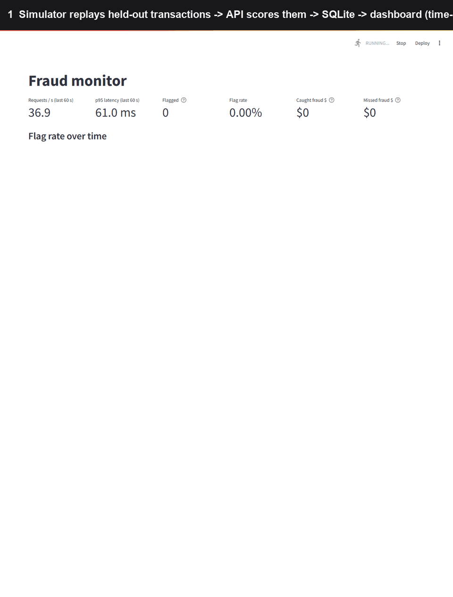
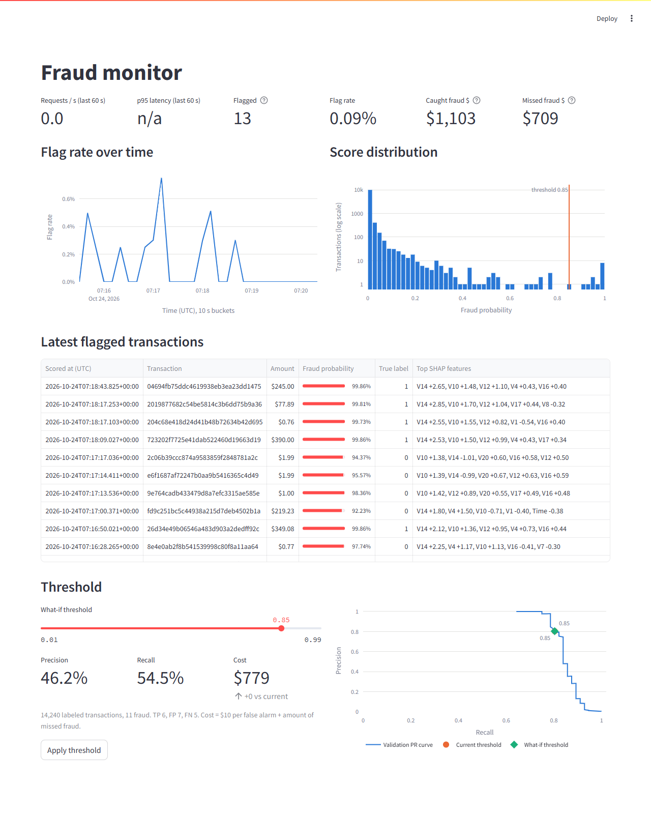
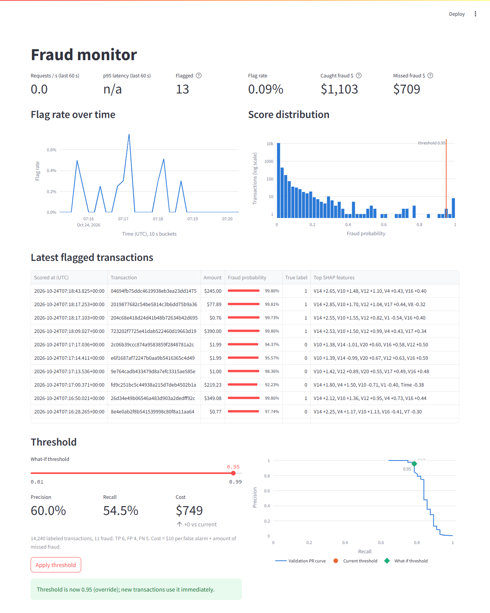

# Fraud Detection System

Real-time credit card fraud scoring. An offline pipeline trains a model on the Kaggle
[Credit Card Fraud](https://www.kaggle.com/datasets/mlg-ulb/creditcardfraud) dataset, a FastAPI service
scores transactions, a simulator streams held-out transactions at it, and a Streamlit dashboard shows
the results live and lets you change the decision threshold.

```text
creditcard.csv -> pipeline (split, train, evaluate) -> artifacts/
                                                            |
simulator --POST /score--> API (FastAPI) --background--> SQLite (WAL) --read-only--> dashboard (Streamlit)
                              ^                                                          |
                              +----------------- PUT /threshold --- Apply button --------+
```



*A time-lapse of the real dashboard (running under Docker Compose) while the simulator streams the replay
slice, then the what-if slider and Apply button in use.*

## How the dashboard helps

**1. Watch the stream and see why a transaction was flagged.** Throughput and p95 latency, flag rate, and
the dollars caught and missed, with a feed of flagged transactions and the SHAP features that pushed each
one over the threshold. (The `True label` column exists only because the simulator knows the labels;
a real deployment has none at scoring time.)



**2. Tune the threshold with evidence before applying it.** The slider recalculates precision, recall and
cost from the scores and labels already stored, with no call to the API. On the full replay slice
(14,240 transactions, 11 fraud) at threshold 0.85 the model catches 6 frauds with 7 false alarms
(cost $779). Raising the threshold to 0.95 keeps the same 6 caught, cuts false alarms to 4, and lowers
cost to $749. Lowering it to 0.30 adds 60 false alarms (cost $1,379) and still misses the same 5 frauds, so
those misses are a model limitation, not a threshold problem. Apply sends `PUT /threshold` and new
transactions use the new value immediately.



## Quick start (Docker)

Needs Docker with Compose, and `data/creditcard.csv` from Kaggle (`mlg-ulb/creditcardfraud`, 284,807 rows).

```bash
# 1. train the model inside Docker (writes artifacts/; takes a few minutes)
docker compose --profile train run --rm pipeline

# 2. start the API (http://localhost:8000/docs) and dashboard (http://localhost:8501)
docker compose up --build

# 3. in another terminal, stream the held-out replay slice at the API
docker compose --profile sim up simulator
```

`artifacts/` is mounted read-only into the services and `./data` holds `transactions.db`.
The API refuses to start if `artifacts/` is missing or if `threshold.json` belongs to a different trained
model than `metrics.json` (re-run the pipeline's `evaluate` step).

## Run without Docker

Python 3.11 is the target (Docker uses 3.11; development was done on 3.10).

```bash
pip install -r requirements.txt
python -m pipeline.split       # artifacts/splits/*.parquet
python -m pipeline.train       # model.joblib, scaler.joblib, metrics.json
python -m pipeline.evaluate    # threshold.json, final test metrics
uvicorn api.main:app --port 8000
python -m simulator.stream_txns --rate 10
streamlit run dashboard/app.py
pytest -q
```

The `Makefile` wraps these (`make split train evaluate`, `make api`, `make simulate`, `make dashboard`,
`make test`).

## Results

Generated from `artifacts/metrics.json` by `python -m pipeline.readme_table` (`make readme`).

<!-- results:start -->
**Model selection** (validation slice, time-ordered split):

| Candidate | Val PR-AUC | Val ROC-AUC |
| --- | ---: | ---: |
| `logreg` | 0.8395 | 0.9829 |
| `xgboost` (selected) | 0.8522 | 0.9862 |
| `smote_xgboost` | 0.8189 | 0.9887 |

**Final metrics** at the validation-chosen threshold t* = 0.85 (test slice scored once; model `xgboost`, version `2026-10-24T05:12:36Z`):

| Metric | Validation | Test |
| --- | ---: | ---: |
| PR-AUC | 0.8522 | 0.8238 |
| ROC-AUC | 0.9862 | 0.9893 |
| Precision | 0.804 | 0.805 |
| Recall | 0.804 | 0.805 |
| F1 | 0.804 | 0.805 |
| Cost at t* | $276.30 | $1,743.31 |
| Cost at threshold 0.5 | $1,051.55 | $2,153.31 |
| Cost if nothing is flagged | $8,397.70 | $4,357.16 |
| True positives | 45 | 33 |
| False positives | 11 | 8 |
| False negatives | 11 | 8 |
<!-- results:end -->

Read these with care:

- **Few frauds.** Validation has 56, test has 41 and the replay slice has 11, so every figure moves a lot
  when a handful of transactions change. Treat differences in the third decimal as noise.
- **Validation is used three times** (XGBoost early stopping, picking the winner, and sweeping the
  threshold), so validation numbers are somewhat optimistic. The test slice is scored once per
  `evaluate` run and never used to tune anything; re-running `evaluate` re-scores it.
- **Platform differences.** XGBoost is not bit-for-bit reproducible across machines. The same code trained
  inside Docker (Linux, Python 3.11) gave XGBoost validation PR-AUC 0.8545, t* = 0.86, test PR-AUC 0.8211
  and test cost $1,763; the table above is from the Windows run. The splits and the logistic regression
  baseline were identical.
- **Accuracy is not reported:** predicting "not fraud" is 99.8% accurate on this data.

## How it works

- **Time-based split, not random.** Rows are sorted by `Time` and sliced 70% train, 15% val, 10% test,
  5% replay. The fraud rate drifts across slices (0.19% in train, 0.08% in replay), which is part of an
  honest evaluation.
- **No leakage.** The scaler (`RobustScaler` on `Time` and `Amount` only) is fit on train and reused
  everywhere. SMOTE only runs inside training cross-validation folds (`TimeSeriesSplit`). The threshold
  is chosen on validation by cost (`$10` per false alarm plus the raw `Amount` of every missed fraud).
  The simulator replays only the `replay` slice.
- **Features.** `Time`, `Amount` and `V1`-`V28` (anonymized PCA components) in a fixed order stored in
  `threshold.json`. There is no card ID, so no per-card or velocity features; SHAP is used for explanations.
- **The API never lets `true_label` reach the model.** It is stored for simulation statistics only.
  Database writes and SHAP run in `BackgroundTasks`, never inline in `/score`.

| Method | Path | Purpose |
|---|---|---|
| POST | `/score` | Score one transaction (30 features, optional `transaction_id` and `true_label`) |
| GET | `/health` | Status, model version, current threshold |
| GET / PUT | `/threshold` | Read or change the decision threshold (in memory, logged to `threshold_history`) |
| GET | `/explain/{transaction_id}` | Top 5 SHAP contributions for a flagged transaction (404 if none) |
| GET | `/metrics/summary` | Counts, flag rate and p95 latency over the last N minutes |

```text
pipeline/    config.py split.py train.py evaluate.py cost_matrix.py readme_table.py
api/         main.py schemas.py scoring.py database.py explain.py latency_check.py
simulator/   stream_txns.py
dashboard/   app.py data.py charts.py whatif.py api_client.py
tests/       unit, API (FastAPI TestClient), simulator and dashboard (Streamlit AppTest) tests
Dockerfile  docker-compose.yml  Makefile  requirements.txt
```

## Known limits

- **Latency.** In-process, 1,000 requests: p95 server-side scoring latency 1.8 ms (`python -m api.latency_check`,
  target under 10 ms). Under Docker Desktop on Windows I could not get a stable figure: p50 ranged 1-15 ms and
  p95 25-60 ms between runs, even though a single-row prediction takes 0.3 ms inside the container and a
  plain busy loop in the same container stalls for up to 41 ms (about 37 ms natively on the same
  machine). That points at host scheduling jitter, but I did not isolate the cause. Treat Docker latency on
  Windows as unmeasured.
- **Throughput.** SQLite writes are serialized through one shared connection. Opening a connection per
  request cost about 42 ms per insert on a Docker bind mount and about 7 ms natively; the shared connection
  brings that to about 2 ms. It is a demo store, not a production database.
- **Model quality.** On the replay slice 5 of the 11 frauds score low enough to be missed at every
  threshold. `Time` is a model feature, and later slices fall outside the range seen in training.
- **No authentication.** Anyone who can reach the API can `PUT /threshold` (for example to 1.0, which turns
  flagging off). The override lives in memory and in one process: it resets on restart, and running several
  workers would give each its own threshold.
- **Containers run as root** so bind mounts work without permission setup. Docker was verified on Docker
  Desktop for Windows only.
- **The simulator always replays from the start of the slice**, and the first fraud is about 1,950 rows in,
  so very short runs flag nothing.
